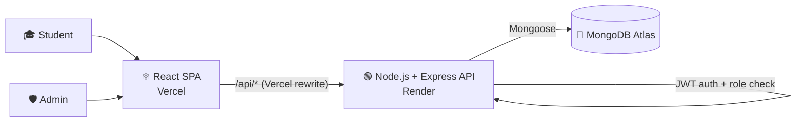

# Student Grants Management System

A full-stack web app for academic grant requests. Students register, fill in a 6-step application and track its status. Administrators review every request and approve or reject it.

🔗 **Live demo:** [student-grants-system.vercel.app](https://student-grants-system.vercel.app)

> ⏳ The backend runs on Render's free tier and sleeps when idle, so the **first request may take up to a minute**.

### 🔑 Try it

| Role | ID number | Password | What you can do |
|---|---|---|---|
| Student | `123456782` | `Demo1234` | Submit a request, track its status |
| Admin | `000000018` | `Admin1234` | See all requests, approve or reject |

> ⚠️ This is a public demo environment. **Please don't enter real personal or bank details.**

---

## 📸 Screenshots

**Student dashboard**


**6-step application form**


**Request status (student)**


**Requests management (admin)**


**Request review and decision (admin)**


---

## ✨ Features

**Student**
- Registration and login with **JWT** authentication and **bcrypt**-hashed passwords
- **6-step application**: personal details, family, studies, bank account, documents, review and submit
- Client-side validation with **React Hook Form**, including Israeli ID check-digit validation
- Draft saving per user, so a student can continue later
- **Request status page**: pending, approved or rejected, updated as soon as an admin decides

**Admin**
- **Requests dashboard**: counters by status, filter by status, search by name or ID number
- **Full request view** with every detail the student submitted
- **Approve / reject** with confirmation

**Security**
- Role-based access: `user` or `admin`. The role can't be chosen at registration, it is assigned in the database
- Every admin endpoint checks the token **and** re-checks the role in the database on each request
- A student's identity for a new request is taken from the JWT, never from the request body, so nobody can submit on behalf of someone else
- Request data (ID numbers, bank details) is never publicly readable

---

## 🏗️ Architecture



### REST API

| Method | Endpoint | Access | Description |
|---|---|---|---|
| `POST` | `/api/auth/register` | Public | Create a student account |
| `POST` | `/api/auth/login` | Public | Log in, returns a JWT |
| `POST` | `/api/requests/submit` | Student | Submit the full application |
| `GET` | `/api/requests/user/:userId` | Student | Status of the student's latest request |
| `GET` | `/api/requests` | Admin | List all requests, newest first |
| `GET` | `/api/requests/:id` | Admin | Full details of one request |
| `PATCH` | `/api/requests/:id/status` | Admin | Approve or reject |

---

## 🛠️ Tech Stack

- **Frontend:** React · Vite · Tailwind CSS · React Router · React Hook Form · SweetAlert2
- **Backend:** Node.js · Express · REST API · JWT · bcrypt
- **Database:** MongoDB · Mongoose
- **Hosting:** Vercel (frontend) · Render (backend) · MongoDB Atlas (database)

---

## 👩‍💻 My Contribution

This started as a team project at **Alei Be'er** (2026), where each team member built different parts. When the seminar ended, the app was not yet connected end to end, so I completed it on my own.

**During the team project**
- Set up the initial project structure (React + Vite client, Express server layout)
- Built the **request status page** and its server endpoint
- Built the **bank details step** with validation
- Worked on the step navigation component (`HeadSteps`)

**Completed on my own after the seminar**
- Built the missing **personal details step** and added the **mother's details** to the family step
- Connected all 6 steps to **one shared form state** and wired the final **submit** to a new JWT-protected endpoint
- Added **user roles** and built the **admin side**: requests dashboard, request review page, approve/reject flow
- Secured the API: authentication middleware, admin-only middleware, removed public access to request data
- **Deployed** the app (Vercel, Render, MongoDB Atlas) and fixed production-only bugs, such as import paths that only worked on Windows because of case-insensitive file names

---

## 🚀 Running Locally

**Requirements:** Node.js 20+ and MongoDB (local or Atlas)

**Backend**

```bash
cd server
npm install
npm start          # http://localhost:5000
```

Environment variables (optional for local runs):

| Variable | Default |
|---|---|
| `MONGO_URI` | `mongodb://127.0.0.1:27017/student-grants` |
| `JWT_SECRET` | a development-only fallback. **Always set it in production** |

**Frontend**

```bash
cd client
npm install
npm run dev        # http://localhost:5173
```

The Vite dev server forwards `/api` requests to the backend on port 5000, the same way `vercel.json` does in production.

**Making a user an admin:** register normally, then set `"role": "admin"` on that user's document in the `users` collection.

---

## 🔭 Next Steps

- **File storage:** documents in step 5 are currently stored by file name only. The next step is uploading them to cloud storage (for example Cloudinary or S3) so admins can open them.
- Email notification to the student when a request is approved or rejected.

---

Original team repository: [final-project-team-kuk/student-grants-system](https://github.com/final-project-team-kuk/student-grants-system)
